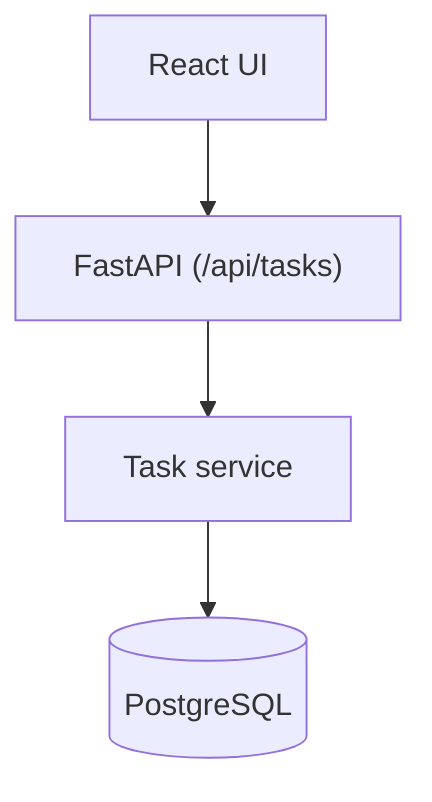
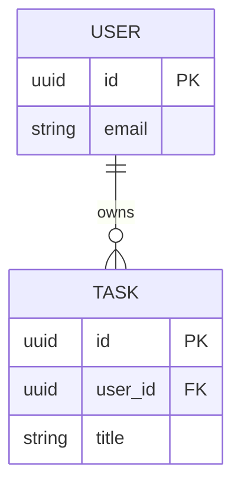
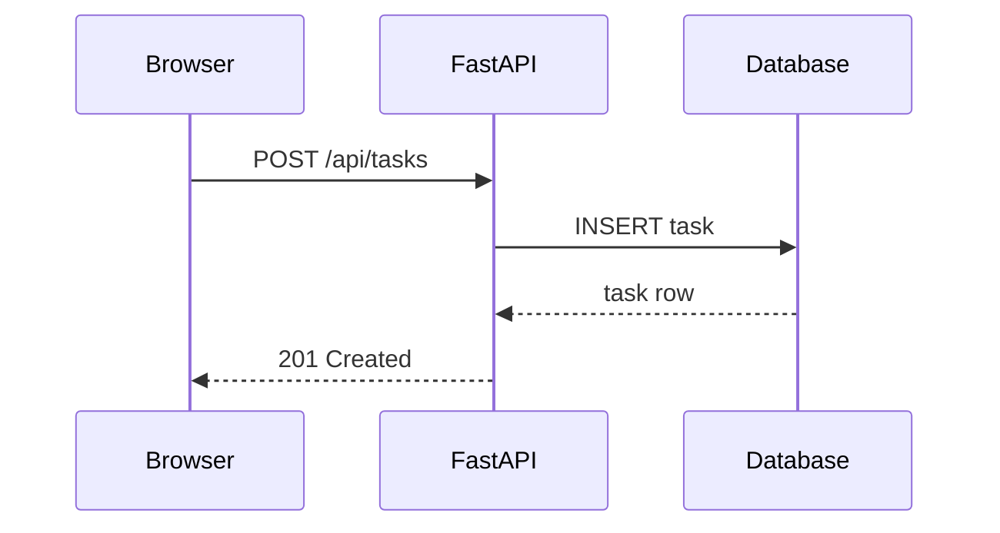

# Mermaid diagrams

Diagrams in Markdown must render in VS Code and GitHub on the first try. A single unquoted bracket or stray character turns the whole block into an error box, so follow the syntax rules below exactly. Put each diagram in a fenced ```` ```mermaid ```` block.

## Diagrams to include
1. **System architecture** (`flowchart TD`): UI, backend routes/services, and data layers.
2. **Database schema** (`erDiagram`): tables, column types, PK/FK keys. Include whenever a database is present.
3. **Request sequence** (`sequenceDiagram`): step-by-step lifecycle of the core feature.

Skip a diagram type that does not apply (e.g. no ER diagram without a database).

## Strict syntax rules
- Quote any flowchart node text containing spaces, slashes, brackets, parentheses or colons:
  - Good: `API["FastAPI (/api/tasks)"]`
  - Bad: `API[FastAPI (/api/tasks)]`
- Use short alphanumeric node ids (`API`, `DB`, `UI`); never use `end` as an id.
- In `sequenceDiagram` labels, avoid raw parentheses and quotes (rephrase in plain words). `;` and `#` also break labels; write them as `#59;` and `#35;`.
- Declare sequence participants up front with simple aliases: `participant B as Browser`.
- In `erDiagram`, column types are single words (`string`, `int`, `uuid`); mark keys with `PK`/`FK`; relationships use `||--o{` style with a quoted label.
- Keep each diagram scannable: at most 12–15 nodes. Split into several diagrams rather than cramming.
- When auditing, fix existing diagrams in place and keep their meaning unchanged.

## Examples






